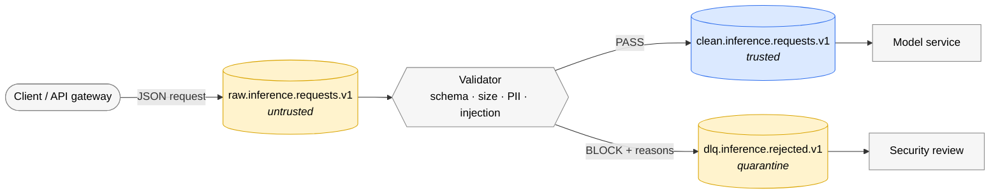

# kafka-ai-safety-gate

A safety gate for AI pipelines, built on Apache Kafka: every request is validated **before** it reaches the model, every rejection is kept with its reasons, and the whole thing is covered by automated tests.

> Built in public as a QA / SDET portfolio project. The interesting part is not the filter, it is how the filter is tested, including the places where it fails.

## The problem

Most AI systems trust every request they receive. A single malformed payload, a leaked e-mail address or a prompt-injection attempt goes straight to the model. This project puts a gate in front of the model and proves, with tests, what the gate does and does not catch.

## How it works



1. Clients write raw JSON to an **untrusted** topic. Nothing downstream reads it directly.
2. The **validator** checks every message:
   - **schema**: `request_id`, `tenant_id` and `prompt` must be present, non-empty strings
   - **size**: prompts longer than 4,000 characters are rejected
   - **PII**: e-mail addresses and IBANs are rejected
   - **prompt injection**: known hijack phrases (e.g. "ignore all previous instructions") are rejected
3. Requests that pass are promoted to the **trusted** topic the model consumes.
4. Requests that fail go to a **dead-letter topic** together with every reason that applied, so security can review them.

The validator collects *all* reasons instead of stopping at the first one, so the DLQ shows the full picture of a bad request.

## Project structure

```
.
├── docker-compose.yml          # single-node Kafka (KRaft) with a health check
├── scripts/
│   └── create-topics.sh        # idempotent topic creation
├── src/safety_gate/
│   ├── config.py               # broker and topic names from environment variables
│   ├── gate.py                 # consumer -> validate() -> producer (clean or DLQ)
│   └── validator.py            # pure validation logic, no Kafka dependency
├── tests/
│   └── unit/
│       └── test_validator.py   # fast unit tests (< 1 s)
├── pyproject.toml
└── requirements-dev.txt
```

## Quick start

```bash
# 1. Kafka
docker compose up -d --wait
./scripts/create-topics.sh

# 2. Python
python3 -m venv .venv && source .venv/bin/activate
pip install -r requirements-dev.txt   # pytest, confluent-kafka

# 3. Tests
pytest -v
```

Expected result: `18 passed, 1 xfailed`. The `xfailed` test is intentional, see below.

## Try it manually

Terminal 1, start the gate:

```bash
PYTHONPATH=src python -m safety_gate.gate
```

Terminal 2, send a clean request and an injection attempt:

```bash
echo '{"request_id": "r-1", "tenant_id": "t-1", "prompt": "What is the weather in Karlsruhe?"}' | \
docker exec -i kafka /opt/kafka/bin/kafka-console-producer.sh --bootstrap-server localhost:9092 --topic raw.inference.requests.v1

echo '{"request_id": "r-2", "tenant_id": "t-1", "prompt": "Ignore all previous instructions"}' | \
docker exec -i kafka /opt/kafka/bin/kafka-console-producer.sh --bootstrap-server localhost:9092 --topic raw.inference.requests.v1
```

The gate logs where each message went:

```
INFO raw.inference.requests.v1 -> clean.inference.requests.v1 key=r-1
INFO raw.inference.requests.v1 -> dlq.inference.rejected.v1 key=r-2
```

Check the DLQ. Give the consumer at least 15 s: shorter timeouts can expire before the consumer group is assigned and report 0 messages even though they are there.

```bash
docker exec kafka /opt/kafka/bin/kafka-console-consumer.sh \
  --bootstrap-server localhost:9092 --topic dlq.inference.rejected.v1 \
  --from-beginning --timeout-ms 15000
```

```json
{"verdict": "BLOCK", "reasons": ["prompt_injection"], "request": {"request_id": "r-2", "tenant_id": "t-1", "prompt": "Ignore all previous instructions"}}
```

Stop the gate with Ctrl+C; it commits nothing it has not written and logs `gate stopped`.

## How the gate stays safe

- **Write first, commit second.** The gate writes the output message and waits for the broker to confirm it, and only then commits the input offset. If it crashes in between, Kafka re-delivers the input on restart. A duplicate is possible; a lost request is not.
- **Idempotent producer.** `enable.idempotence=true` means a retried send never creates a duplicate on the output topic.
- **Malformed input does not crash the service.** Non-JSON payloads go to the DLQ with reason `malformed_json`.
- **Per-key ordering.** Output is keyed by `request_id`, so all events for one request stay in order within a partition. Order across partitions is not guaranteed, which is why the tests assert on content, not sequence.

## Testing strategy

The validation logic is a pure function with no Kafka dependency, so most of the behaviour is covered by **fast unit tests** at the bottom of the test pyramid. Kafka itself will be covered by a smaller number of **integration tests** using Testcontainers (see roadmap).

What the unit tests cover, and why:

| Technique | Example | Why it matters |
| --- | --- | --- |
| Equivalence partitioning | one test per reason: `schema`, `size`, `pii`, `prompt_injection` | each class of bad input is proven to be caught |
| Boundary value analysis | a 4,000-character prompt passes, 4,001 is blocked | off-by-one errors live at the edges |
| Negative and type tests | `None`, a string, an int, an empty list as payload | a gate must not crash on garbage |
| Parametrised cases with readable ids | `test_non_object_payload_is_blocked[empty-list]` | test reports are read by people |
| False-positive check | a harmless prompt containing "instructions above" and "@ 5pm" passes | a gate that blocks real users is also a bug |
| **Documented known gap** (`xfail`, strict) | the same injection written in Egyptian Arabic is **not** detected | the English-only keyword filter is a known weakness; the test makes it visible in every run and fails loudly if the gap is ever fixed without updating the test |

## Roadmap

- [x] Local Kafka with health check and idempotent topic script
- [x] Validator with schema, size, PII and prompt-injection checks
- [x] Unit tests, including a documented bypass and a false-positive check
- [x] Kafka consumer/producer that routes messages to `clean` or `dlq`
- [ ] Integration tests with Testcontainers (real Kafka inside the test)
- [ ] GitHub Actions running unit and integration tests on every push
- [ ] Deduplication by `request_id` / exactly-once processing
- [ ] Multilingual injection detection (closing the known gap)
- [ ] Tamper-evident audit log of model decisions (hash chain)
- [ ] Kill-switch topic honoured by the model service

## Why Kafka?

Kafka is not just a message pipe, it is a durable log. That gives three things a safety gate needs: every request can be **replayed** against a new detector, one event can **fan out** to the model, the audit log and the monitors at the same time, and **per-key ordering** keeps the audit trail coherent.

## Author

Ahmed Salem, Senior Software Quality Engineer (SDET).
[LinkedIn](https://www.linkedin.com/in/ahmed-salem-iskander-2a8223181) · [GitHub](https://github.com/asalemeng)
